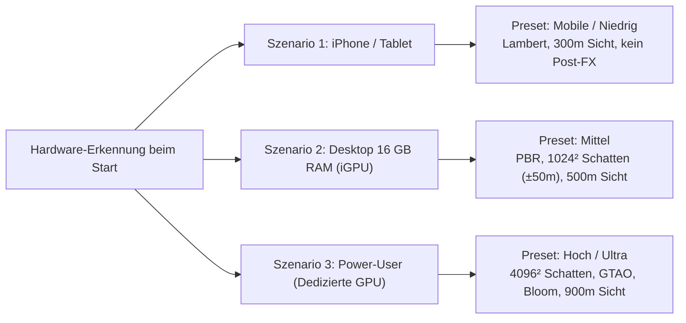

# Konzept & Architektur: web.bornheim

**Stand:** November 2026  
**Live-Version:** [https://nixblick.github.io/web.bornheim/](https://nixblick.github.io/web.bornheim/)

---

## 1. Vision & Grundprinzip

**web.bornheim** ist ein vollständig im Browser laufendes Open-World-Spiel, das ganz Frankfurt am Main im Maßstab 1:1 aus realen Geodaten (OpenStreetMap + Hessisches Geländemodell DGM1) spielbar macht – mit Fokus auf den Stadtteil Bornheim als Ursprungsort.

### Design-Säulen
- **Zero-Backend & Zero-Build:** Reines ES-Modul-JavaScript mit lokal vendorisiertem Three.js (`0.170.0`). Keine Server-Logik, kein Login, keine externen CDNs oder Tracker. Jeder statische Webserver (oder GitHub Pages) genügt.
- **Reale Topografie statt Kulisse:** 342,5 km² Stadtgebiet (1.370 Kacheln à 500×500 m), 46 Stadtteile, 84 U-Bahn-Stationen und über 21,7 Millionen reale Höhenmesspunkte (4-Meter-Raster). Der Bornheimer Hang, der Main und alle Brücken/Rampen sind physikalisch exakt abgebildet.
- **Satirisch-politische Sandbox:** Neben klassischer Open-World-Action (Fahrzeuge, Waffen, Fahndungssterne) stehen urbane Protestkultur, Demonstrationen, Polizei-Eskalationsstufen, Bürgerdialoge und Kiez-Geschichten im Mittelpunkt.
- **Prozedurale & Synthetische Leichtgewichtigkeit:** Sämtliche Soundeffekte (Motoren, Sirenen, Schüsse, Wasserwerfer, Regen, Donner) werden in Echtzeit über die Web Audio API synthetisiert (0 Byte Audio-Assets).

---

## 2. Ist-Stand: Architektur & Module

| Modul | Datei(en) | Funktion im Ist-Stand |
|---|---|---|
| **Kern & Engine** | `game.js`, `play.html` | Kachel-Streaming, DGM1-Terrain, Gebäudegenerierung, Tag/Nacht/Wetter, Verkehr, Passanten-KI, Fahr- & Schwimmphysik, Kollision (`moveWithCollision`), Post-Processing, HUD & Menü |
| **Waffen & Pyro** | `weapons.js` | 15+ Ausrüstungsgegenstände: Nahkampf, Schusswaffen, Pfefferspray, Taser, Farbbeutel, Böller, Rauchtopf, Bengalo, Granate, Zeitzünder-TNT (`T`), Molotow |
| **Demo & Polizei** | `demo.js` | Spontane & geführte Demos, Sprechchöre, 5 Eskalationsstufen (Streife → Polizeikette → Kessel → Wasserwerfer → Räumung), Ingame-Social-Feed, Filmen (`V`) |
| **Story-Engine & Kampagnen** | `story.js`, `story2.js`, `story3.js` | Missions-System mit GPS-Routing, Dialog-System, Fraktions-Ruf, Waffen-Sperren (`WPN.lock`) und 3 vollwertigen Storylines mit je 3 Enden |
| **Feuer & Rettung** | `fire.js` | Dynamische Brandausbreitung (Autos, Tonnen, Grünflächen), Hitze-Schaden, anrückende Feuerwehr mit Löschfahrzeug, Schläuchen und Absperrung |
| **Innenräume & U-Bahn** | `interiors.js` | Taschenraum-System (`X = 60000`) für begehbare Wohnhäuser (Treppenhaus + Aufzug aufs Dach), 84 U-Bahn-Stationen mit Liniennetz-Schnellreise und betretbare Läden |
| **Wirtschaft & Läden** | `shops.js` | Aus echten OSM-POIs generierte Geschäfte (Kiosk, Supermarkt, Bäcker, Apotheke, Baumarkt, Sportladen) mit Regalen, Verkäufern und Inventar-Kauf |
| **Luftfahrt** | `heli.js` | Rettungshubschrauber „Christoph 2“ auf dem Dach-Helipad der BG Unfallklinik Seckbach inkl. Aufzug und eigener Flugphysik |
| **Fortschritt & RPG** | `progress.js` | EP- und Level-System (Boni auf Fahrzeug-Robustheit, Ladenpreise, Sprinttempo), Stadtteil-Entdeckung (46 Bezirke), Statistik-Overlay (`Tab`) |
| **Mobile & Touch** | `touch.js` | Automatisch injizierte Touch-Oberfläche mit virtuellem Twin-Stick, Kontext-Buttons und mobilem Grafik-Preset |
| **Qualitätssicherung** | `tools/selftest.js`, `fahren.js`, `laufen.js`, `bugjaeger.js` | 76 Integritäts-Checks, 16 Fahrphysik-Prüfungen, 5 Fußgänger-Tests und ein autonomer Monkey-Testing-Agent |

---

## 3. Ist-Stand: Gameplay & Weltsysteme

### 3.1 Stadt-Streaming & Geometrie
- **Zweistufiges Kachel-Streaming:** Kacheln (500×500 m) werden im Datenradius `R_DATA` geladen und im engeren Radius `R_MESH` als 3D-Geometrie gebaut. Ein Frame-Zeitbudget (`buildT`) verteilt die Mesh-Erzeugung über mehrere Frames.
- **Distanz-LOD & Merging:** Entfernte Kacheln starten im `far`-LOD und werden bei Annäherung aufgerüstet (`makeUpgrade`). Gebäude, Straßen, Gehwege und Dächer werden pro Kachel via `mergeGeometries` zusammengefasst, um Draw-Calls drastisch zu senken.
- **Speicher-Hygiene:** Verlassene Kacheln geben ihre Geometrien (`unbuildTile`) und ab `R_DATA + 2` auch ihre Rohdaten, Höhenraster und Minimap-Caches (`unregisterTile`) frei. Knochen-Texturen von despawnten NPCs werden explizit aus dem VRAM gelöscht (`freeSkel`).

### 3.2 Fortbewegung & Physik
- **Zu Fuß & Klettern:** Laufen, Sprinten, Springen, Fallschaden. Über Treppenhäuser oder Aufzüge sind Flach- und Steildächer begehbar.
- **Straßenfahrzeuge:** 7 GLB-Automodelle (Limousine, Kleinwagen, SUV, Taxi, Streifenwagen, Kombi, Fließheck) plus prozedurale Fahrräder (`makeBike`), Motorräder und Rettungswagen.
- **Fahrphysik:** Reifenhaftung (wetterabhängig), Handbremsen-Drift mit Bremsspuren, Karosserieneigung, Hangabtrieb an Steigungen ab 4 %, präzises Entlangschrammen an schrägen Wänden (`moveWithCollision`) und OBB-Kollision zwischen Fahrzeugen.
- **ÖPNV & Luftweg:** Oberirdische Straßenbahnen auf realen Gleisen, 84 unterirdisch begehbare U-Bahn-Stationen mit animierten Zügen sowie der fliegbare Hubschrauber „Christoph 2“.
- **Wasser & Schwimmen:** Schwimmen in Main und Teichen mit Ausdauer-/Atemluft-System (90 s an der Oberfläche, 15 s Tauchen mit `Strg`).

### 3.3 Story-Kampagnen
1. **Story 1 – „Bornheim bleibt“ (5 Kapitel, 3 Enden):** Kampf gegen den Verkauf eines Bornheimer Parks im Hitzesommer (Plakate, Großdemo, Wasserwerfer-Konfrontation, Finale vor dem Stadtrat).
2. **Story 2 – „Freitag ist Pflicht“ (6 Kapitel, 3 Enden):** Klimastreik an Frankfurter Schulen (Flyer auf dem Schulhof, Sternmarsch dreier Schulen, nächtlicher Autobrand mit Feuerwehreinsatz, Polizeikessel, Finale am Stadthaus Ost).
3. **Story 3 – „Der Kanzler kommt“ (3 Kapitel, 3 Enden):** Gewaltfreie Satire rund um einen abgeriegelten Kanzler-Besuch im Saalbau Bornheim (Bürgerfragen am Kiosk, Sicherheitszone, Kolonnen-Blockade).

---

## 4. Hardware-Szenarien: Ist-Stand & Ausblick

Die Engine erkennt beim Start die GPU und das Eingabegerät und wählt automatisch das passende Profil. Zusätzlich regelt eine dynamische Auflösungsanpassung (`dynres`) die interne Renderauflösung zwischen `0.7` und `1.0`, sobald die Framerate unter 25 FPS fällt.

---

### Szenario 1: iPhone & Tablet (iOS / iPadOS / Android Touch)

#### Ist-Stand
- **Automatisches Profil (`mobile`):** Sichtweite 300 m, Render-Scale `0.8`, keine Schatten, kein Post-Processing (`EffectComposer` komplett umgangen), reduzierte Passanten- und Verkehrsdichte (`0.6`), kleinerer Datenradius (`R_DATA = 2`).
- **Speicher-Footprint:** Unter 300 MB VRAM/WebKit-Memory. Damit überlebt die App die strengen Speichergrenzen von Mobile Safari ohne Tab-Reloads.
- **Bedienung:** Vollwertiges Touch-UI (`touch.js`) mit virtuellem Stick, Kamera-Touchpad und kontextsensitiven Aktionsbuttons. PWA-fähig über `manifest.webmanifest`.

#### Ausblick (Was noch möglich ist)
1. **Gyroskop-Lenkung & Aiming:** Optionale Neigungssteuerung beim Autofahren und beim Zielen mit dem Wasserwerfer/Waffen über die `DeviceOrientationEvent`-API.
2. **Haptisches Feedback & Mobile Audio-Unlock:** Vibration (`navigator.vibrate` auf Android / Haptic-Fallbacks) bei Kollisionen, Explosionen und Schüssen sowie nahtloses Resume des `AudioContext` nach iOS-Hintergrundwechsel.
3. **Service Worker & Offline-Kachel-Cache:** Ein Service Worker, der das Kern-Spiel und die Kacheln rund um Bornheim in der `Cache API` / `IndexedDB` ablegt, sodass das Spiel auf dem Smartphone auch im Flugmodus oder in der echten Frankfurter U-Bahn komplett offline startet.
4. **Adaptive Touch-HUD-Layouts:** Spezifische Layouts für iPad/Tablets (geteilte Ränder für Daumenbedienung im Querformat) vs. kompaktes Einhand-/Hochformat-Layout für schnelle Kiez-Spaziergänge auf dem iPhone.

---

### Szenario 2: Normaler Desktop mit 16 GB RAM (Integrierte GPU: Intel UHD / Iris Xe / AMD Vega, Apple M-Basis)

#### Ist-Stand
- **Automatisches Profil (`Mittel` bzw. `Niedrig` auf älterer Intel HD):** Direkter Render-Pfad ohne schweren Multi-Pass-Composer, PBR-Materialien mit PMREM-Umgebungslicht, 4x anisotrope Filterung.
- **Optimierte Schatten:** 1024² Shadow-Map mit einer eng um den Spieler geführten ±50 m Bounding-Box (~10 cm pro Texel). Liefert auf einer Intel UHD ca. 37–42 FPS bei scharfen Nahbereichsschatten.
- **CPU- & RAM-Auslastung:** Dank Instancing (1 Draw-Call für bis zu 150–600 Partikel, gechunkte Parkreihen) und striktem Kachel-Abbau belegt der Browser-Tab im 16-GB-System dauerhaft nur ca. 600–900 MB RAM.

#### Ausblick (Was noch möglich ist)
1. **Web Worker für Kachel-Geometrie (`OffscreenCanvas` / Worker-Meshing):** Auslagerung der CPU-intensiven `buildTile`-Extrusion (Gebäudewände, Dächer, Straßen-Merging) in einen Hintergrund-Web-Worker, der fertige `Float32Array`-Buffer per Zero-Copy (`Transferable`) an den Main-Thread übergibt. Das eliminiert selbst kleinste Mikroruckler beim schnellen Fahren.
2. **Komprimierte binäre Kacheldaten:** Umstellung oder Ergänzung der `data/tiles/*.json` durch ein kompaktes Binärformat (oder vorberechnete Geometrie-Chunks), was JSON-Parse-Zeiten und Garbage-Collection-Pausen auf Mittelklasse-CPUs halbiert.
3. **Baked Vertex-AO für Gebäude:** Vorberechnete Umgebungsverdeckung in den Vertex-Farben am Fuß von Gebäuden und unter Dachüberständen. Gibt der Stufe „Mittel“ die optische Tiefe von Ambient Occlusion zum Nulltarif für die iGPU.
4. **Intelligentes Traffic-Culling & Spatial Hashing:** Räumliche Gitter-Indizes für Passanten- und Fahrzeug-Kollisionen, damit die CPU auf 16-GB-Office-Laptops problemlos die doppelte Menschenmenge bei Großdemos berechnen kann.

---

### Szenario 3: Power-User mit dedizierter GPU (NVIDIA RTX / AMD Radeon RX / Apple M-Pro/Max)

#### Ist-Stand
- **Automatisches Profil (`Hoch` / manuell `Ultra`):** Voller HDR-Post-Processing-Stack über `EffectComposer` (`HalfFloatType`, MSAA).
- **Grafik-Features:**
  - **GTAO (Ground Truth Ambient Occlusion):** 14 Samples + 10 Denoise-Samples bei 0.75× Auflösung (mit selektivem Ausblenden von Transparenzen und Baumkronen im AO-Pass).
  - **Schatten & Beleuchtung:** 4096² Soft-Shadow-Map (±95 m Box), `UnrealBloomPass` für Laternen, Blaulicht, Feuer und Scheinwerfer, `GradeShader` für Farbkorrektur und Wettereffekte.
  - **Sichtweite & Details:** Bis zu 900 m Sichtweite (`R_MESH = 2`), 1.800 reaktive geparkte Fahrzeuge, 60 Blattflächen pro Baumkrone, maximale Textur-Anisotropie (16×).
- **Aktuelle Auslastung:** Selbst auf „Ultra“ nutzt das Spiel auf modernen RTX-Karten weniger als 1,5 GB VRAM und hat enorme GPU-Reserven.

#### Ausblick (Was noch möglich ist)
1. **WebGPU-Backend & Compute Shaders:** Migration/Dual-Support auf den `WebGPURenderer` von Three.js. Ermöglicht GPU-gestützte Partikelphysik (Zehntausende Wassertropfen beim Wasserwerfer, Funkenregen, dichter Pyro-Rauch mit echter Strömung) und drastisch reduzierten CPU-Draw-Call-Overhead.
2. **Cascaded Shadow Maps (CSM) & Dynamische Punktlicht-Schatten:** Ablösung der einzelnen Shadow-Map durch 3–4 Kaskaden für gestochen scharfe Schatten vom Bordstein bis zur 1,5 km entfernten Frankfurter Skyline (Commerzbank-Tower, Messeturm, EZB), ergänzt um echte Schattenwürfe durch Autoscheinwerfer und Blaulicht bei Nacht.
3. **Screen-Space Reflections (SSR) & Pfützen-Physik:** Echte Echtzeit-Spiegelungen von Neonreklamen, Blaulicht, Ampeln und Fassaden auf regennassen Frankfurter Straßen sowie auf der Wasseroberfläche des Mains.
4. **Skyline-Horizont-Layer (Ultra-Far LOD):** Ein permanenter Low-Poly-Horizont-Layer für alle Hochhäuser im Bankenviertel und den Fernmeldeturm („Ginnheimer Spargel“), der unabhängig vom 900-m-Kachelradius aus jedem Winkel der Stadt als echter 3D-Orientierungspunkt sichtbar bleibt.
5. **Lokale KI-NPCs via WebGPU (WebLLM):** Auf PCs mit starker GPU (ab 8–12 GB VRAM) könnten ausgewählte Story-Charaktere, Kioskbesitzer oder Passanten über ein lokal im Browser laufendes Quantized-LLM dynamisch in Frankfurter Mundart auf freie Texteingaben des Spielers und das aktuelle Demo-Geschehen reagieren.

---

## 5. Strategische Roadmap (Priorisierung)

| Phase | Fokus | Wichtigste Maßnahmen | Zielgruppe |
|---|---|---|---|
| **Phase 1: Quick Wins** | Feinschliff & Doku | README-Abgleich (Innenräume/U-Bahn/Heli dokumentieren), Baked Vertex-AO für Häuserkanten, Gyro-Steuerung für Mobilgeräte | Alle |
| **Phase 2: Streaming 2.0** | CPU-Entlastung & Offline | Web-Worker für `buildTile`-Geometrie, PWA Service-Worker für Offline-Caching der Kernkacheln, Skyline-Horizont-Mesh | Mobile & 16-GB-Desktop |
| **Phase 3: Next-Gen Grafik** | High-End-Optik | Cascaded Shadow Maps (CSM), Screen-Space Reflections (SSR) bei Regen, dynamische Scheinwerfer-Schatten bei Nacht | Power-User (GPU) |
| **Phase 4: Content & KI** | Spieltiefe | Begehbare Wahrzeichen (EZB, Römer, Hauptbahnhof), Fahrrad-Kuriere/Rennen, optionale WebGPU-LLM-Dialoge | Alle / Power-User |

---

## 6. Bereits umgesetzte Ausbau-Maßnahmen (Branch `ausbau-2026`)

Im Worktree `ausbau-2026` wurden die wichtigsten Maßnahmen für alle drei Hardware-Klassen bereits ohne Performance-Einbußen umgesetzt:

1. **Vollständige iPhone-/Tablet-Steuerung & Kreativmodus (`touch.js`, `game.js`, `weapons.js`, `play.html`):**
   - **Kreativmodus auf Mobilgeräten:** Eigener `🛠`-Button in der oberen Touch-Leiste sowie im Pausemenü (`#m_creative`), horizontal wisch- und tippbare `#hotbar` für alle 23 Kreativ-Werkzeuge/Spawner und direktes Platzieren über den Hauptaktionsknopf (`SETZEN`).
   - **Kontextabhängige Touch-Buttons:** Automatische Umschaltung zwischen `SPRUNG`, `BREMSE` (Auto), `TAUCHEN` (im Main), `▲ HOCH` / `▼ RUNTER` (Kreativflug) und `▲ STEIGEN` / `▼ SINKEN` (Hubschrauber Christoph 2) sowie `💦 WASSER` im Wasserwerfer.
   - **Zusatzaktionen:** Kontextbuttons für Hupe/Klingel/Martinshorn (`📢`/`🔔`/`🚨`, `KeyH`), Fahrzeuglicht (`💡`, `KeyL`), Nachladen (`↻`, `KeyR`) und Zeitzünder (`⏱`, `KeyT`). Antippen von Untertiteln überspringt Dialoge (`KeyX`), Antippen der Waffenleiste (`#wbar`) wählt Waffen direkt aus.
   - **Analoge Lenkung, Gyroskop & Haptik:** Stufenloser Lenkausschlag über den virtuellen Stick (`player.touchSteer`), optionale Neigungslenkung (`opts.gyro`), Vibrations-Feedback (`opts.vibrate`) und automatisches Aufwecken des iOS-WebAudio-Kontexts.
   - **Interaktive große Karte (`#bigmap`):** Verschieben per Finger/Maus (`mapPanX`/`mapPanZ`), Zwei-Finger-Pinch-Zoom, Zentrieren per Kompass-Tipp/Doppelklick und Schließen-Button (`✕`).
2. **Zero-Cost Optik & Frankfurter Skyline für alle Geräte (`game.js`):**
   - **Permanente 3D-Skyline-Horizontschicht (`SKYLINE_TOWERS`):** 44 echte Frankfurter Hochhäuser ab 80 m (Europaturm, Commerzbank Tower, Messeturm, FOUR, Westend Tower, Main Tower, EZB, Henninger Turm u. a.) als ein einziges `InstancedMesh` (1 Draw-Call) inklusive nächtlicher roter Flugsicherungs-Befeuerung (`skylineBeacons`). Blendet kachelweise automatisch aus, sobald die echte Detailkachel vor Ort gebaut ist.
   - **Baked Vertex-AO an Gebäuden:** Vertikaler Umgebungsverdeckungs-Verlauf in den Vertex-Farben aller Hauswände und Erdgeschoss-Bänder (Straßenschlucht-Abdunkelung und Gehweg-Kontaktschatten bei 0 ms GPU-Mehrkosten).
3. **Adaptive Streaming-Budgets & Dynamische Nachtbeleuchtung (`game.js`, `sw.js`):**
   - **Adaptives Kachel-Baubudget (`stepJob`):** Skaliert das Zeitbudget pro Frame anhand der geglätteten Frametime (`_smoothFt`) automatisch zwischen 4,5 ms (unter Last) und 13 ms (auf schnellen 16-GB-/GPU-Systemen).
   - **Gepooltes Scheinwerfer- & Blaulicht (`updateDynLights`):** Echtes `SpotLight` für das Spielerfahrzeug bei Nacht und dynamisches `PointLight` für aktives Blaulicht auf den Stufen `Hoch` und `Ultra` (`opts.dynlights`).
   - **Offline-fähiger Service Worker (`sw.js`):** Speichert 3D-Modelle, Texturen und besuchte Frankfurter Stadtkacheln (`data/tiles/*.json`, `data/dem/*.bin`) lokal im Browser-Cache für sofortige Ladezeiten und Offline-Spielbarkeit.

